<div align="center">

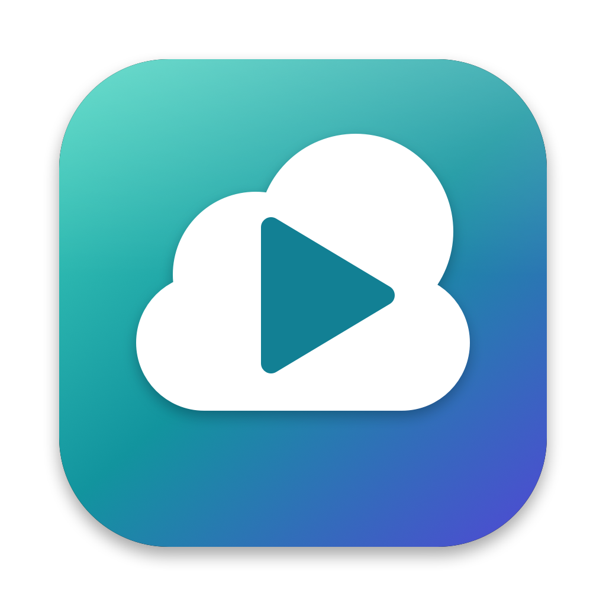

# TrueCloud for iPhone

**Your TrueCloud gaming PC on your iPhone. Start it, tap Play, and you're in.**<br>
TrueCloud built into the open-source Moonlight client: one app, automatic pairing, no addresses or PINs to type.

<p>
  
  
  
  
  
  
  
</p>

<p><a href="#install-with-sidestore-no-xcode-needed"><b>Install</b></a> &nbsp;·&nbsp; <a href="#a-whole-session-on-one-screen">Screenshots</a> &nbsp;·&nbsp; <a href="#what-it-does">What it does</a> &nbsp;·&nbsp; <a href="#glass-on-screen-controls-placed-where-you-want-them">Controls</a> &nbsp;·&nbsp; <a href="#build-and-install">Build and install</a> &nbsp;·&nbsp; <a href="#how-it-works">How it works</a> &nbsp;·&nbsp; <a href="#made-by">Made by</a></p>

<p>
  <a href="https://discord.gg/GVDYtpWHps"></a><br>
  <b>Need help, found a bug, or have an idea?</b> Join the community: get help, report bugs and suggest features for TrueCloud.
</p>

</div>

> [!IMPORTANT]
> **Unofficial project.** This is an independent client built to show [TrueCloud](https://truecloud.in), with their permission.
> It is not made, endorsed or supported by TrueCloud. "TrueCloud" belongs to its owners; the icon and the teal theme are original.
> Use it with your own TrueCloud account, and follow TrueCloud's terms of service.

<br>

<table>
  <tr>
    <td width="25%" valign="top"><picture><source media="(prefers-color-scheme: light)" srcset=".github/screenshots/light-login.png">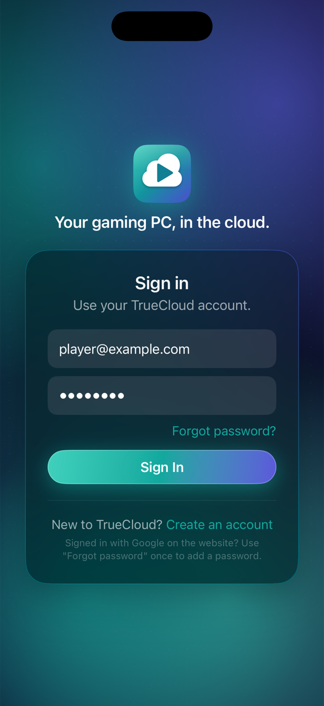</picture></td>
    <td width="25%" valign="top"><picture><source media="(prefers-color-scheme: light)" srcset=".github/screenshots/light-step-idle.png">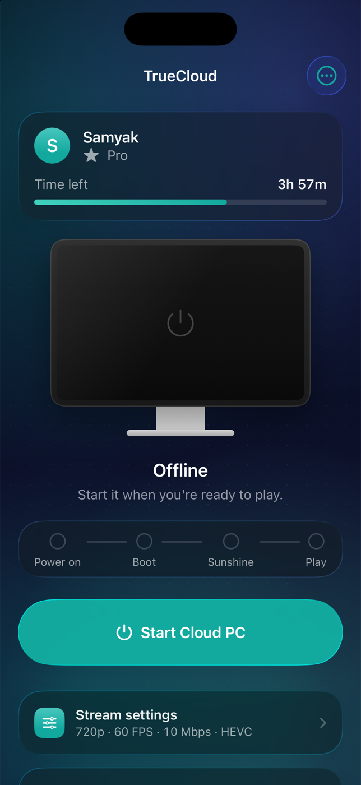</picture></td>
    <td width="25%" valign="top"><picture><source media="(prefers-color-scheme: light)" srcset=".github/screenshots/light-step-ready.png">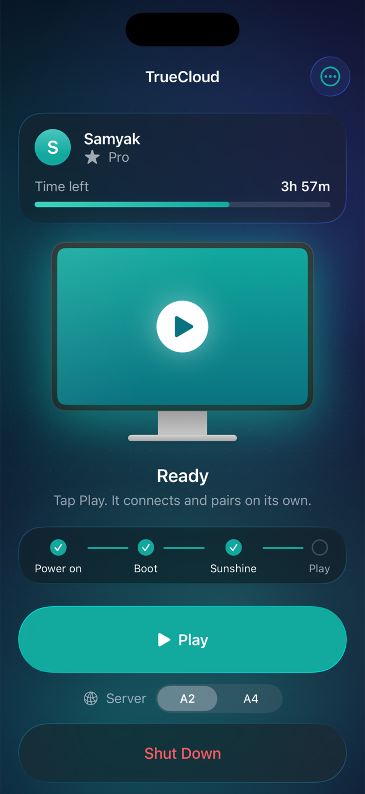</picture></td>
    <td width="25%" valign="top"><picture><source media="(prefers-color-scheme: light)" srcset=".github/screenshots/light-step-streaming.png">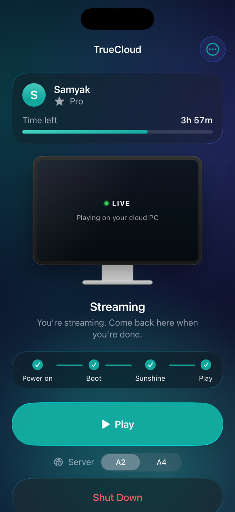</picture></td>
  </tr>
</table>

<br>

## A whole session on one screen

The home screen answers one question: what is my cloud PC doing right now?
A drawn monitor shows the answer, the track under it shows how far along you are, and there is only ever one main button.

<table>
  <tr>
    <td width="25%" valign="top">
      <picture><source media="(prefers-color-scheme: light)" srcset=".github/screenshots/light-step-idle.png"></picture>
      <p align="center"><b>Offline</b><br><sub>One button to start.</sub></p>
    </td>
    <td width="25%" valign="top">
      <picture><source media="(prefers-color-scheme: light)" srcset=".github/screenshots/light-step-starting.png">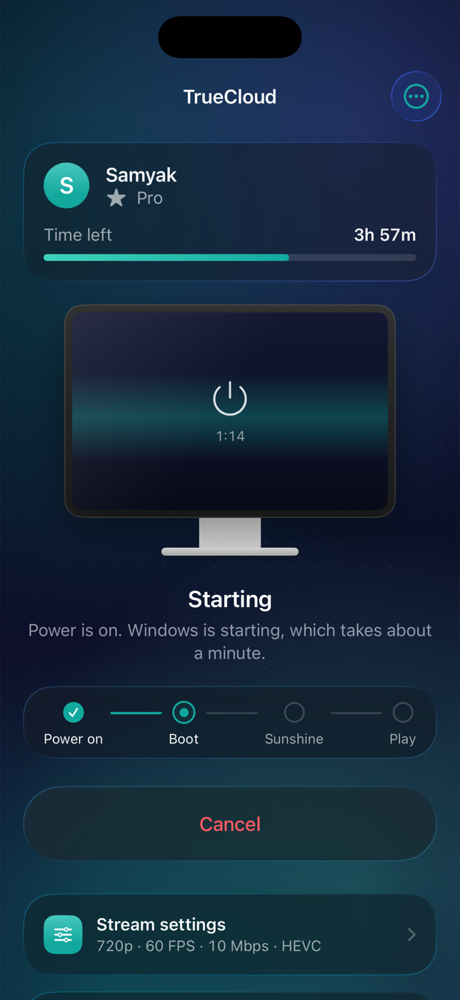</picture>
      <p align="center"><b>Starting</b><br><sub>TrueCloud powers on your rig.</sub></p>
    </td>
    <td width="25%" valign="top">
      <picture><source media="(prefers-color-scheme: light)" srcset=".github/screenshots/light-step-booting.png">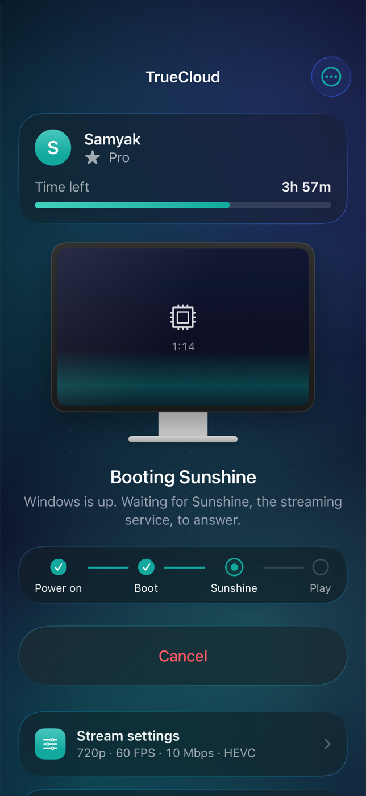</picture>
      <p align="center"><b>Booting</b><br><sub>Windows and Sunshine come up.</sub></p>
    </td>
    <td width="25%" valign="top">
      <picture><source media="(prefers-color-scheme: light)" srcset=".github/screenshots/light-step-ready.png"></picture>
      <p align="center"><b>Ready</b><br><sub>Tap Play when you are.</sub></p>
    </td>
  </tr>
  <tr>
    <td width="25%" valign="top">
      <picture><source media="(prefers-color-scheme: light)" srcset=".github/screenshots/light-step-pairing.png">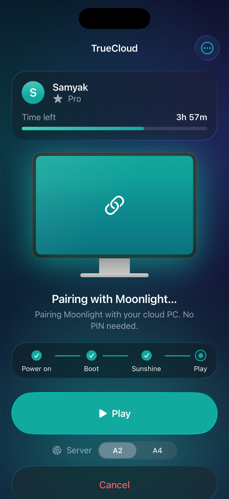</picture>
      <p align="center"><b>Pairing</b><br><sub>Moonlight pairs itself. No PIN to type.</sub></p>
    </td>
    <td width="25%" valign="top">
      <picture><source media="(prefers-color-scheme: light)" srcset=".github/screenshots/light-step-streaming.png"></picture>
      <p align="center"><b>Streaming</b><br><sub>You're playing. The app waits.</sub></p>
    </td>
    <td width="25%" valign="top">
      <picture><source media="(prefers-color-scheme: light)" srcset=".github/screenshots/light-settings.png">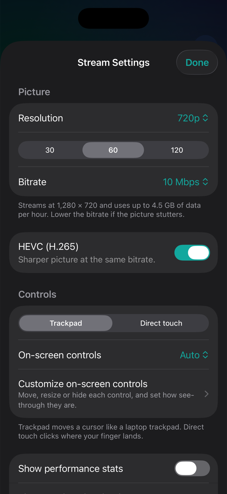</picture>
      <p align="center"><b>Stream settings</b><br><sub>Saved straight into Moonlight.</sub></p>
    </td>
    <td width="25%" valign="top">
      <picture><source media="(prefers-color-scheme: light)" srcset=".github/screenshots/light-network.png">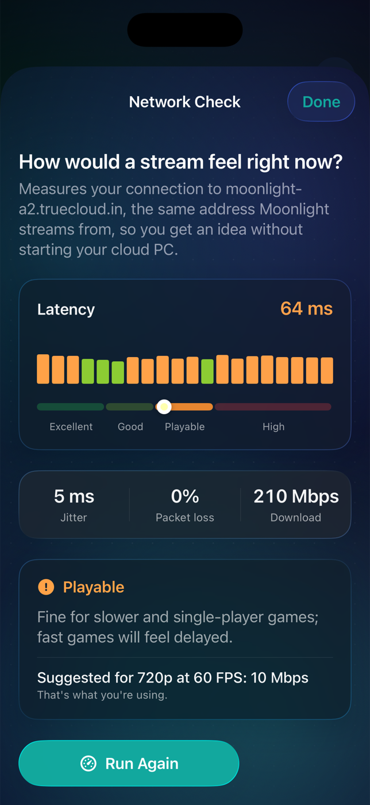</picture>
      <p align="center"><b>Network check</b><br><sub>Before you start the PC.</sub></p>
    </td>
  </tr>
</table>

## Your plan, and what your cloud PC is doing

The plan card shows the date your plan ends, and while the cloud PC runs you can see how much data it is moving.

<table>
  <tr>
    <td width="33%" valign="top">
      <picture><source media="(prefers-color-scheme: dark)" srcset=".github/screenshots/dark-plan-ready.png">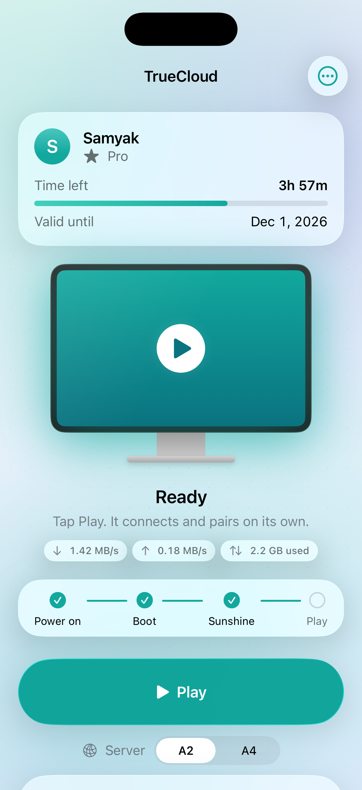</picture>
      <p align="center"><b>Valid until, and network usage</b><br><sub>Download, upload and data used so far.</sub></p>
    </td>
    <td width="33%" valign="top">
      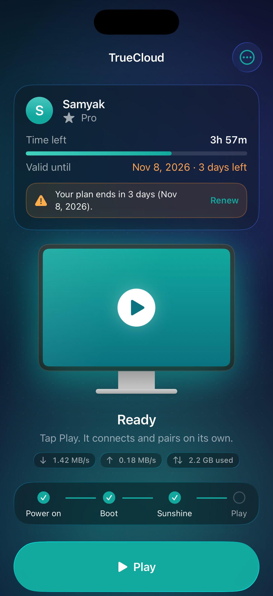
      <p align="center"><b>Ending soon</b><br><sub>A warning under 5 days, with a Renew link.</sub></p>
    </td>
    <td width="33%" valign="top">
      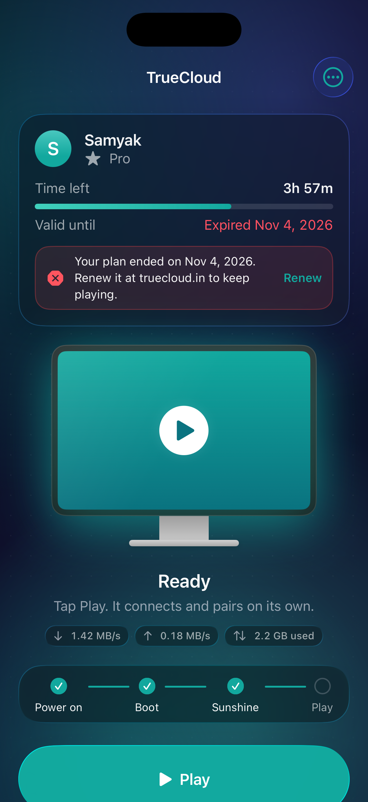
      <p align="center"><b>Ended</b><br><sub>Start explains why it can't start.</sub></p>
    </td>
  </tr>
</table>

## Activity and payments

<table>
  <tr>
    <td width="50%" valign="top">
      <picture><source media="(prefers-color-scheme: dark)" srcset=".github/screenshots/dark-activity.png">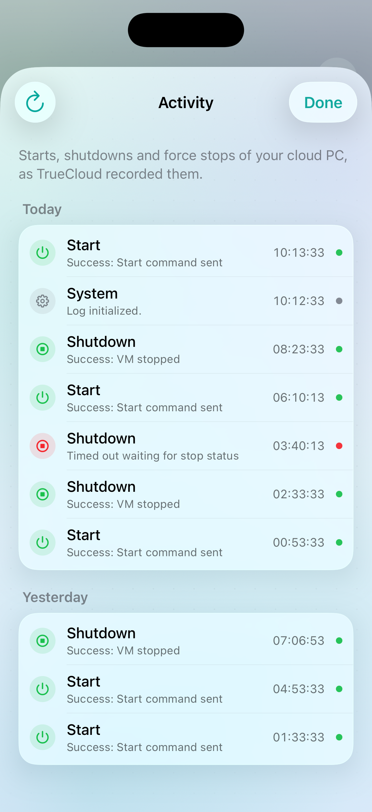</picture>
      <p align="center"><b>Activity</b><br><sub>Every start, shutdown and force stop, and how it went.</sub></p>
    </td>
    <td width="50%" valign="top">
      <picture><source media="(prefers-color-scheme: dark)" srcset=".github/screenshots/dark-payments.png">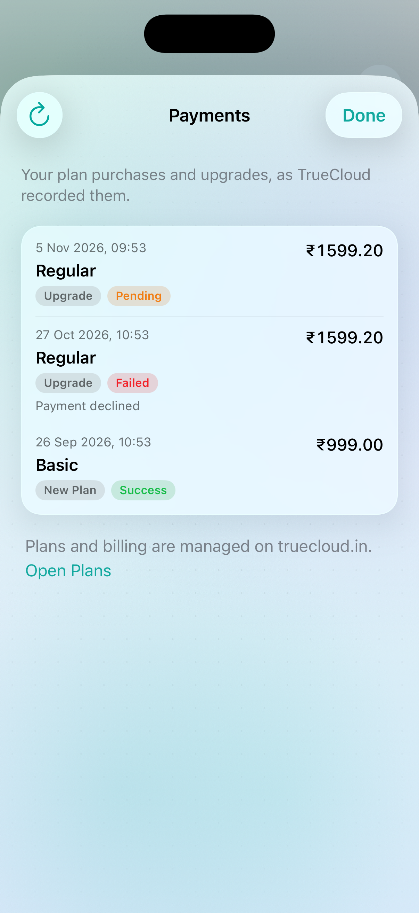</picture>
      <p align="center"><b>Payments</b><br><sub>Your purchases and upgrades, and why a payment failed.</sub></p>
    </td>
  </tr>
</table>

The activity log is TrueCloud's own record of your cloud PC's power events, so it is also the quickest way to show their support exactly what happened
(for example a shutdown that "timed out waiting for stop status"). Your IP address, which TrueCloud stores with each entry, is never shown.

## What it does

The app is called **TrueCloud** on your home screen and opens straight into it, in portrait. Moonlight only
does the streaming underneath; you never see its host list or settings.

- **Sign in** with email and password. The password is never stored; only the refresh token is, in the iOS Keychain.
- **Your plan up top:** time left this month, your plan name and the date the plan ends, with a warning when it is close and a clear message when it has ended.
- **Network usage** while the cloud PC runs: download and upload speed, and the data used so far.
- **Activity** (every start, shutdown and force stop with its result) and **Payments** (purchases, upgrades and failures), from the home screen.
- **Works for every account.** The app reads your own rig's address and Moonlight port from your TrueCloud profile, as the website does, so it doesn't assume anyone else's, and it keeps that profile fresh while it is open.
- **Start Cloud PC, then Play.** A drawn monitor and a Power on → Boot → Sunshine → Play track show where the session is.
  Play adds the cloud PC to Moonlight, pairs it (the PIN goes to TrueCloud for you) and launches Desktop in landscape.
- **Back to TrueCloud** as soon as the stream ends.
- **A2 or A4 server picker**, remembered between launches.
- **Shut Down** with a confirmation, plus **Force Stop** and **Unpair All Devices** under the "…" menu, both confirmed.
- **Stream settings in the app:** resolution up to 4K, 30/60/120 FPS, bitrate with data use per hour, HEVC,
  stats overlay and where the sound plays.
- **A Controls screen of its own:** on-screen controls (Off, Auto, Simple, Full), trackpad or direct touch, floating sticks,
  fade when idle, the layout editor and the controller check, all in one place.
- **Network check** before you start: latency to the gateway, jitter, packet loss and download speed, with a verdict and a bitrate suggestion.
- **Controller check:** a drawn controller that mirrors every press, stick and trigger, and tells you whether Moonlight will use it.
- **In-stream overlay:** a small pill with time left and live latency. Tap it for the full card, or to edit the on-screen controls.
  It warns you when the connection gets busy and when plan time is running out.
- **Glass on-screen controls** you can move, resize, remove and fade, with floating sticks that appear under your thumb (below).
- **Liquid Glass on iOS 26,** with a frosted fallback on earlier versions, in light and dark.

Google sign-in, which the website also offers, isn't supported. Use "Forgot password?" on the website once to add a password to a Google-created account.

## Check your controller

<table>
  <tr>
    <td width="30%" valign="top">
      <picture><source media="(prefers-color-scheme: light)" srcset=".github/screenshots/light-controllers.png">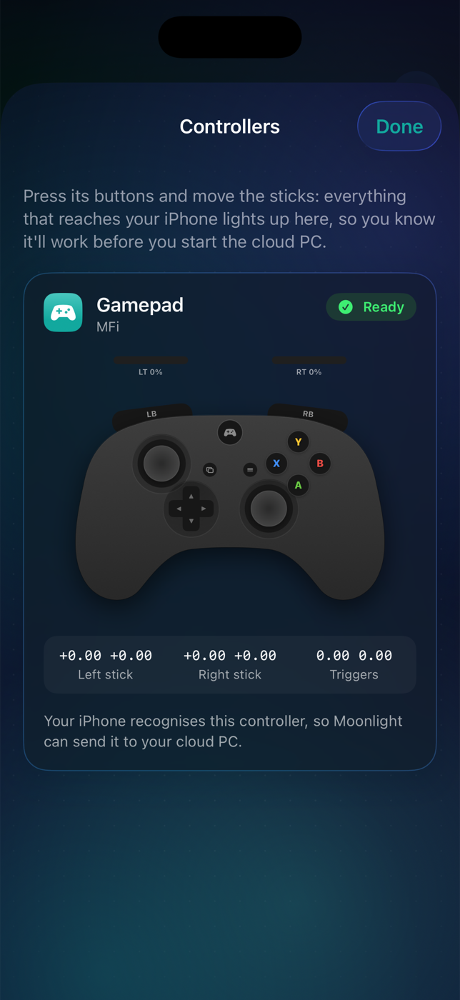</picture>
    </td>
    <td width="70%" valign="top">
      <p>The controller check (<b>Controls → Check a controller</b>) shows whether a controller will work before you start the cloud PC.</p>
      <ul>
        <li><b>A drawn controller that mirrors yours:</b> buttons light up, the sticks move and the triggers fill as you pull them.</li>
        <li><b>Ready to play, or not:</b> whether your iPhone recognises the controller, so Moonlight can send it to the cloud PC.</li>
        <li><b>The numbers:</b> exact stick and trigger values, handy for spotting drift.</li>
      </ul>
    </td>
  </tr>
</table>

## Glass on-screen controls, placed where you want them

No controller handy? The on-screen gamepad is drawn as glass, and you decide where each piece goes. The editor keeps out of the
way: a small pill at the top, the controls themselves in the clear, and a faint blue tint while you edit.

<p align="center">
  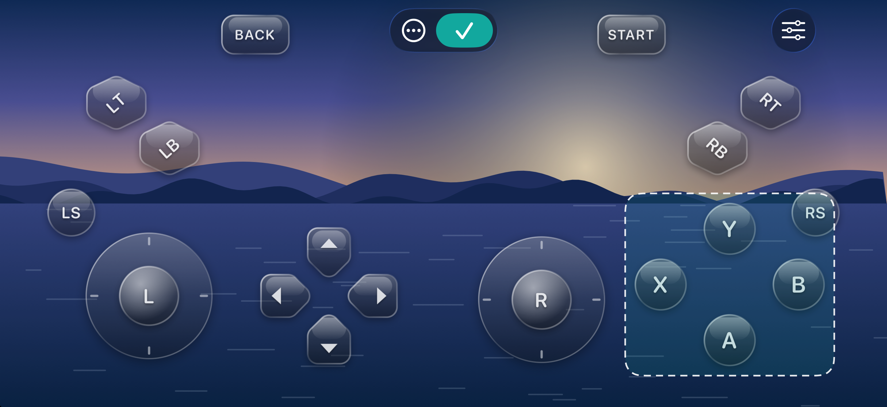
</p>

- **Open the editor** from **Controls → Customize layout** before you connect, or from the **Edit controls** button on
  the overlay card while you're streaming.
- **Drag** any control to move it. It snaps to the centre lines of the other controls and the screen, with a guide line.
- **Pinch** a control to resize it (60% to 180%), or use the **sliders button** at the top right for **Size** and **Opacity**.
  What you see is what you get.
- **Remove** a control by dragging it onto the **bin** at the bottom. Removed controls wait in the tray next to it, and a tap puts one back.
- **Overlaps** get a red outline, so you can tell when two controls sit on top of each other.
- **The ⋯ menu** has **Try it** (previews presses without sending anything), night or day scenery, and **Reset layout**.
  Your layout is saved on the phone and used in every stream.

<p align="center">
  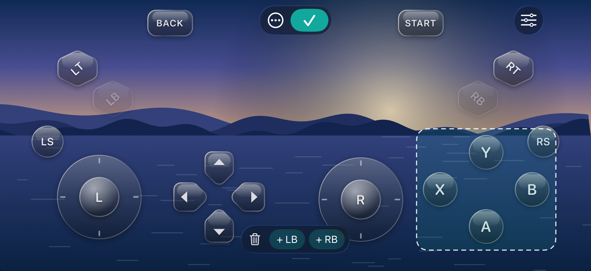
  <br><sub>Removed controls sit in the tray until you put them back.</sub>
</p>

### Floating sticks and fading controls

<table>
  <tr>
    <td width="30%" valign="top">
      <picture><source media="(prefers-color-scheme: light)" srcset=".github/screenshots/light-controls.png">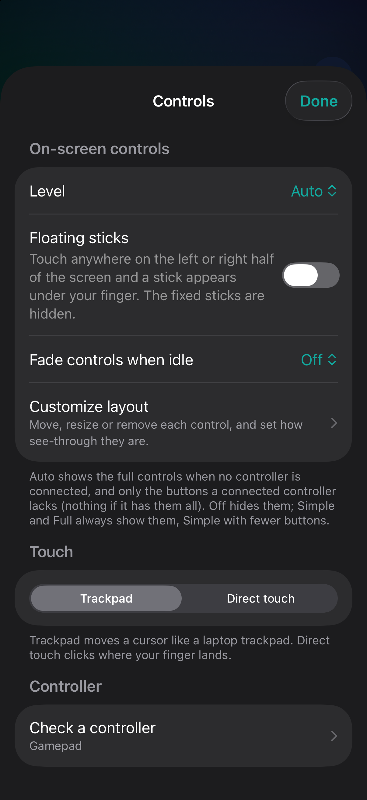</picture>
    </td>
    <td width="70%" valign="top">
      <p>Both live on the <b>Controls</b> screen, next to everything else about input.</p>
      <ul>
        <li><b>Floating sticks:</b> touch anywhere on the left or right half of the screen and a stick appears under your finger. Both thumbs work at once, and the stick keeps working if your thumb slides outside it. Buttons still win when you touch one. The fixed sticks are hidden while this is on.</li>
        <li><b>Fade when idle:</b> the gamepad fades out after 5, 10 or 20 seconds without a touch, and comes back on the next one. Faded controls still respond.</li>
        <li><b>Auto level:</b> shows the full controls when no controller is connected, and only the buttons a connected controller lacks.</li>
      </ul>
    </td>
  </tr>
</table>

<p align="center">
  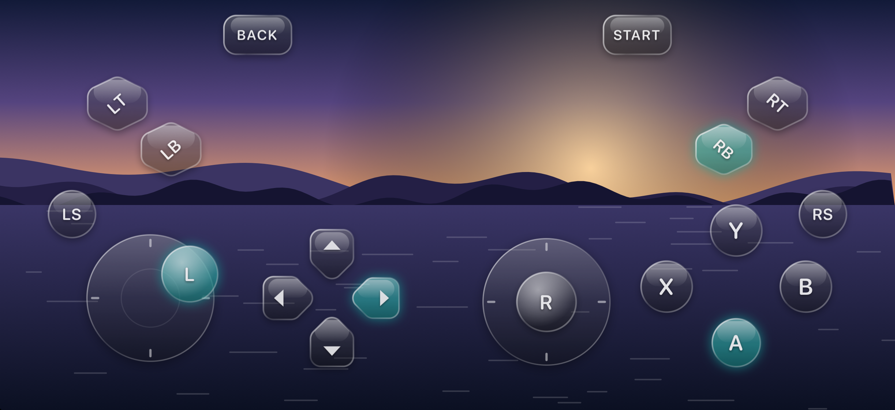
  <br><sub>Pressed controls light up in teal.</sub>
</p>

## Install with SideStore (no Xcode needed)

**[Download TrueCloud-0.1.3.ipa](https://github.com/Sammy970/TrueCloudiPhone/releases/latest)**: unsigned, so it
contains nothing personal, and you sign it with your own Apple ID.

1. Set up [SideStore](https://sidestore.io) on your iPhone (a one-time setup with a computer; their guide walks you
   through it). [AltStore](https://altstore.io) and [Sideloadly](https://sideloadly.io) work too.
2. Download the IPA on your iPhone, then in SideStore go to **My Apps → +** and pick it.
3. SideStore signs it with your Apple ID and installs it. It re-signs it every 7 days in the background, so it keeps
   working. On a free Apple ID it uses one of your three app slots.

## Build and install

Or build it yourself and install it from your Mac. 
Needs a Mac with Xcode, an Apple ID, and a checkout of [Moonlight for iOS](https://github.com/moonlight-stream/moonlight-ios).

```sh
git clone --recurse-submodules https://github.com/moonlight-stream/moonlight-ios   # into ./moonlight-ios
ruby integrate-moonlight.rb                    # needs the xcodeproj gem
cp scripts/renew.env.example scripts/renew.env # set TEAM_ID and BUNDLE_ID
scripts/renew-and-install.sh --integrate       # build with real signing and install on the iPhone
scripts/renew-and-install.sh --build-only      # build only, no phone needed
scripts/make-ipa.sh                            # unsigned IPA for SideStore or AltStore
swift test                                     # TrueCloudKit tests (two read-only live checks)
```

Builds signed with a free Apple ID stop opening after 7 days. Run `scripts/renew-and-install.sh` again to renew.

<details>
<summary><b>Preview mode</b>, for working on the UI in the simulator</summary>
<br>

Debug builds can open any screen with a sample account, without touching the Keychain or the network. This is how the screenshots above were made.

```sh
scripts/sim-build.sh                                   # Debug build for the iPhone 17 Pro simulator
scripts/sim-shot.sh home:ready ready                   # launches a preview and saves .github/screenshots/ready.png
APPEARANCE=light scripts/sim-shot.sh home:idle:network light-network 16
```

| `TRUECLOUD_PREVIEW` | Shows |
|---|---|
| `login` | The sign-in screen |
| `home:<phase>` | `checking`, `idle`, `starting`, `booting`, `ready`, `pairing`, `streaming` or `shutting` |
| `home:<phase>:settings`, `:network`, `:controls`, `:controllers`, `:about` | That sheet over the home screen; add `:sample` for a sample controller |
| `home:<phase>:activity`, `:payments` | The Activity or Payments sheet, with sample data |
| `home:<phase>:expiring`, `:expired` | The plan card with the plan ending in 3 days, or ended yesterday |
| `controls`, `controls:selected`, `controls:play`, `controls:bright` | The on-screen controls editor, with a control selected, held down, or on the day scene |
| `controls:selected:options`, `controls:selected:removed` | The editor with the Size and Opacity card open, or with two controls removed so the tray shows |
| `controls:selftest` | Runs the input-logic checks and logs the result |

`TRUECLOUD_APPEARANCE=light|dark` forces the appearance and `TRUECLOUD_SNAPSHOT=<name>` saves the screen after it settles.

</details>

## How it works

```
Sign in ──▶ Start Cloud PC ──▶ boot ──▶ Sunshine answers ──▶ ready
                                                               │
                                                             Play
                                                               │
                         add host ──▶ pair (PIN sent to TrueCloud) ──▶ stream "Desktop"
```

- `Sources/Kit` is `TrueCloudKit` (Firebase sign-in, Firestore profile, the activity log and payments, network speeds, the Server Action resolver and the rig API), shared with the Mac app.
- `Sources/Shared` holds the session, sign-in and views shared with the Mac app. `Sources/iOS` is the iPhone panel, the glass on-screen
  controls and their editor, the controller check, the stream settings and the Activity and Payments sheets.
- `moonlight-objc.patch` hooks Moonlight's Objective-C (AppDelegate, MainFrameViewController, StreamView, VideoDecoderRenderer, Info.plist) so the app opens into
  the panel, adds the host on Play, pairs and launches Desktop in the app.
- `integrate-moonlight.rb` applies the patch to `moonlight-ios/` (a checkout of moonlight-stream/moonlight-ios, ignored by git),
  adds all Swift sources to the Moonlight target and installs the icon and launch assets.

**Pairing.** Moonlight shows its own random PIN and waits for Sunshine. The app catches that PIN and sends it to TrueCloud
repeatedly (first after 3 seconds, then every 3 seconds, for up to 2 minutes) until it is accepted or Moonlight reports that pairing ended.

**Stream address.** `moonlight-a2.truecloud.in:35450`, or the A4 gateway, chosen on the home screen. Moonlight finds the HTTPS port itself.

TrueCloud has no public API; the app uses the same endpoints as its website, and they can change without notice.

## Made by

<table>
  <tr>
    <td width="96" valign="middle"><a href="https://github.com/Sammy970"></a></td>
    <td valign="middle">
      <b>Samyak Jain</b><br>
      <sub>Designed and built TrueCloud for iPhone and Mac, from reading the website's own requests to the last animation.</sub><br><br>
      <a href="https://github.com/Sammy970"></a>
      <a href="https://x.com/Sammy_970"></a>
    </td>
  </tr>
</table>

<p align="center">
  <picture><source media="(prefers-color-scheme: dark)" srcset=".github/screenshots/dark-about.png">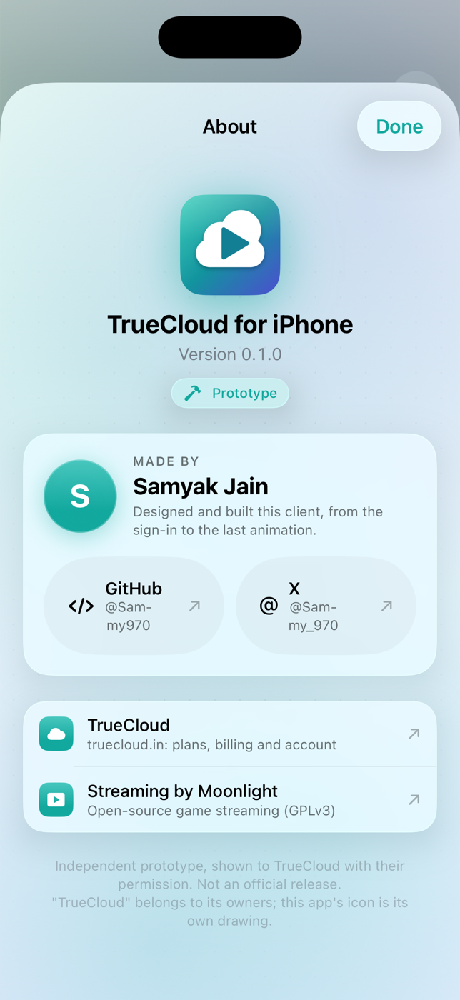</picture>
  <br><sub>The same credits live in the app, under <b>About</b>.</sub>
</p>

## Notes

Unofficial client, not affiliated with TrueCloud. It is [Moonlight for iOS](https://github.com/moonlight-stream/moonlight-ios) with a
TrueCloud panel in front, and Moonlight is GPL-3.0 licensed; see `LICENSE`.
